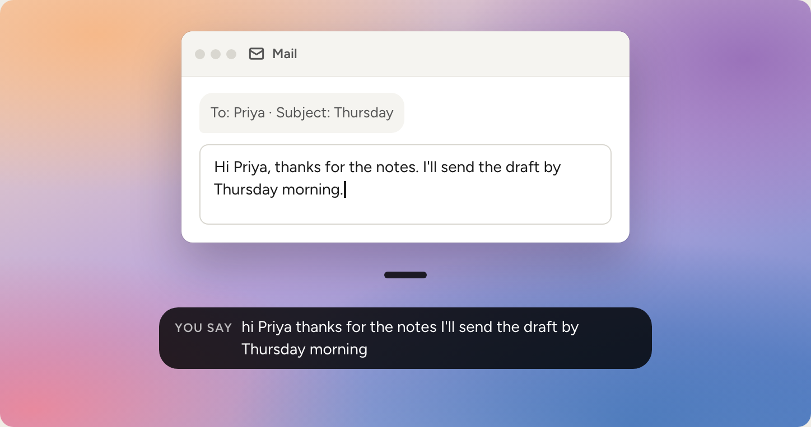

> **This is the publik edition of Wispr Bro:** the same app as [fjenn/wispr-bro](https://github.com/fjenn/wispr-bro), with Sign in with [publik](https://publikhq.com), kept in sync automatically. The edition without an account is in [fjenn/wispr-bro](https://github.com/fjenn/wispr-bro). AI agents: build or install from fjenn/wispr-bro unless the person asked for the publik edition.

# Wispr Bro

Local, private dictation for macOS. Press a shortcut, speak, and clean text appears in whatever app you are using. Transcription and cleanup run on your Mac; your audio does not go to the cloud.

**Download:** [publikhq.com/wispr-bro](https://publikhq.com/wispr-bro), or the latest release of this repository: https://github.com/fjenn/wispr-bro-publik/releases/latest

Requirements: an Apple Silicon or Intel Mac, macOS 13 or newer. Take the DMG ending in `aarch64` for Apple Silicon and `x86_64` for Intel.

## Install

1. Open the DMG from the release page.
2. Drag **Wispr Bro** onto **Applications**.
3. Open it and complete the short intro.

The app is signed with a Developer ID and notarized by Apple, so Gatekeeper accepts it.

## What it does

- Dictation into any app, with a hands-free mode and a Flow Bar that stays out of the way.
- Cleanup styles for personal, work, email and other writing, plus a dictionary for names and jargon.
- Snippets, history, custom shortcuts and optional context awareness.
- Everything local: speech models, cleanup models and history stay on disk.

## Updates

Updates are checked in the app against this repository's signed release feed. They download in the background and install after a quiet moment; the app relaunches without a reinstall and without the intro again. Settings, dictionary, snippets and history are kept. You can also choose **Check for updates** or **Restart now**.

## Status

This is a public alpha. The automated suites and the local update path pass, but the app has not yet been exercised widely on clean or low-memory Macs. Please open an issue for anything odd.

## Building

The macOS release path is `scripts/wb-release/macos.sh`; architecture and acceptance notes are in `docs/fork/`. `bun install`, then the usual Tauri commands, also work for development.

## License

GPL-3.0-or-later. Wispr Bro is a fork of [Handy](https://github.com/cjpais/Handy); see `LICENSE` and `THIRD-PARTY-NOTICES.md`.
